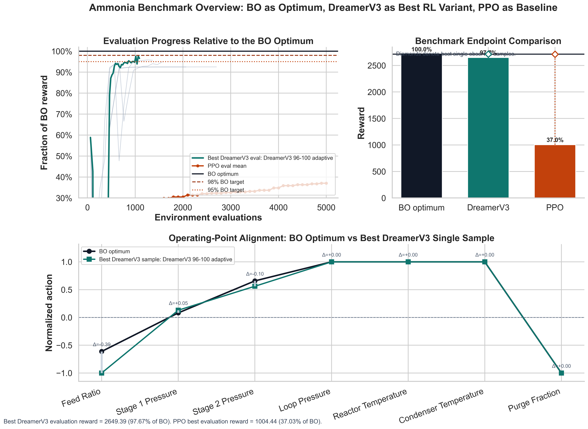

# Ammonia Process Control Benchmark: Bayesian Optimization, DreamerV3, and PPO

A portfolio-style benchmark project comparing model-based and model-free reinforcement learning approaches for an ammonia process-control optimization task.

This repository packages the final publication-ready results from a benchmark study evaluating:

- Bayesian Optimization (BO)
- DreamerV3
- PPO

The analysis focuses on controller quality, stability, operating-point performance, and benchmark comparison across the evaluated methods.

## Highlights

- End-to-end benchmarking of learning-based controllers in a realistic ammonia process setting
- Side-by-side comparison of algorithmic performance and operating characteristics
- Final publication-ready summary tables, rankings, and benchmark figure exports
- Clean repository layout designed for sharing with collaborators, stakeholders, and potential employers

## Benchmark overview



## Repository contents

```text
.
├── README.md
├── LICENSE
├── final/
│   ├── ammonia_benchmark_overview.png
│   ├── ammonia_benchmark_overview.pdf
│   ├── benchmark_summary.csv
│   ├── benchmark_summary.tex
│   ├── dreamerv3_best_run_summary.csv
│   ├── dreamerv3_ranking.csv
│   ├── dreamerv3_ranking.tex
│   ├── operating_point_comparison.csv
│   ├── operating_point_comparison.tex
│   ├── action_profile_comparison.csv
│   ├── ppo_baseline_summary.csv
│   └── statistical_summary.csv
└── .gitignore
```

## Final deliverables

The `final/` directory contains the publication-ready artifacts used for summarizing the study, including:

- benchmark summary tables and rankings
- operating-point comparison outputs
- action-profile comparison outputs
- final benchmark overview figure in PNG and PDF formats
- statistical summary exports for downstream analysis and reporting

## Project focus

This work sits at the intersection of:

- reinforcement learning
- industrial process control
- optimization under operating constraints
- reproducible benchmarking and result packaging

## Notes

- The repository is structured to keep only the final, presentation-ready results in the public-facing project view.
- Source notebooks and experimental run artifacts were intentionally excluded from the final repository presentation to maintain a clean, professional portfolio layout.

## License

This project is licensed under the MIT License. See [LICENSE](LICENSE) for details.
