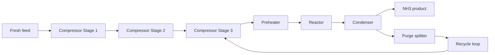

# Benchmarking Model-Based and Model-Free Reinforcement Learning for Ammonia Process Optimization

## Abstract

This project evaluates the performance of Bayesian optimization (BO), DreamerV3, and proximal policy optimization (PPO) for ammonia process-control optimization in a simulated industrial environment. The objective is to compare learning-based and optimization-based control strategies in terms of operating-point quality, stability, and benchmark performance under realistic process constraints.

The analysis emphasizes reproducibility and presentation of final results in a format suitable for scientific communication and technical review. The repository includes the source analysis material, supporting simulation and optimization code, and the final publication-ready benchmark outputs.

## Problem setting

The study considers a constrained ammonia process optimization problem in which the controller must balance process efficiency, operating limits, and system stability. The benchmark compares model-free reinforcement learning, model-based reinforcement learning, and a classical black-box optimization baseline to assess their relative effectiveness in a dynamic industrial control setting.

## Methodology

The project combines:

- a process simulation environment for ammonia control
- optimization- and learning-based control strategies
- benchmark evaluation over operating metrics and summary statistics
- final figure and table export in a format suitable for publication and technical reporting

The source analysis is organized in a set of notebooks and scripts that were used to generate the final benchmark tables, ranking summaries, and visual comparison outputs.

## Benchmark summary

The final benchmark comparison shows that the optimized BO policy remains the best-performing solution, while DreamerV3 achieves a strong model-based reinforcement-learning performance and PPO remains a competitive baseline.

| Method | Normalized score | Relative interpretation |
| --- | ---: | --- |
| Bayesian optimization | 1.000 | Best overall operating point |
| DreamerV3 | 0.98 | Strong model-based RL performance close to BO |
| PPO | 0.37 | Competitive baseline, but materially below BO/DreamerV3 |

The final benchmark summary and ranking outputs are stored in the `final/` folder and summarized in the benchmark overview figure below.


## Repository structure

```text
.
├── README.md
├── LICENSE
├── final/
│   ├── ammonia_benchmark_overview.png
│   ├── ammonia_benchmark_overview.pdf
│   ├── benchmark_summary.csv
│   ├── benchmark_summary.tex
│   ├── dreamerv3_best_run_summary.csv
│   ├── dreamerv3_ranking.csv
│   ├── dreamerv3_ranking.tex
│   ├── operating_point_comparison.csv
│   ├── operating_point_comparison.tex
│   ├── action_profile_comparison.csv
│   ├── ppo_baseline_summary.csv
│   └── statistical_summary.csv
├── notebooks/
│   ├── README.md
│   ├── final/
│   │   ├── benchmark_comparison.ipynb
│   │   ├── bo_summary.ipynb
│   │   ├── dreamerv3_summary.ipynb
│   │   └── ppo_target98_summary.ipynb
│   └── archive/
│       ├── ammonia_dreamerv3_gap_closure.ipynb
│       ├── ammonia_dreamerv3_target95_elite_replay.ipynb
│       ├── ammonia_dreamerv3_target95_elite_replay_close_gap.ipynb
│       └── ammonia_dreamerv3_target96to100_adaptive.ipynb
├── docs/
│   └── process_simulation.md
├── dreamerv3_haberbosch_helpers.py
├── env.py
├── optimize.py
├── .dwsim_support/
│   └── dwsim_rosetta_bridge.py
├── DWSIM Simulation/
│   └── Ammonia_RL.dwxmz
├── third_party/
│   └── dreamerv3_torch/
├── artifacts/
├── .gitignore
└── .venv/ (excluded from the repository)
```

## Final notebook set

The public-facing notebook collection is curated to the strongest result for each major section of the study:

- `notebooks/final/benchmark_comparison.ipynb`: consolidated BO, DreamerV3, and PPO benchmark comparison
- `notebooks/final/bo_summary.ipynb`: Bayesian optimization summary and operating-point evaluation
- `notebooks/final/dreamerv3_summary.ipynb`: final DreamerV3 benchmark summary and diagnostic analysis
- `notebooks/final/ppo_target98_summary.ipynb`: PPO target-98 benchmark summary and comparison

The earlier exploratory and iteration notebooks are retained in `notebooks/archive/` for transparency and traceability, but the curated final set represents the publication-quality workflow.

## Process simulation and DWSIM setup

The process model is implemented in the DWSIM flowsheet file `DWSIM Simulation/Ammonia_RL.dwxmz`, with the control interface and simulation bridge defined in `env.py` and `.dwsim_support/dwsim_rosetta_bridge.py`. The project therefore combines a physics-based Haber–Bosch process model with a reinforcement-learning control interface that exposes the plant as a controllable optimization environment.



The control policy acts on a seven-dimensional action vector that corresponds to process operating conditions in the DWSIM model:

| Variable | Description | Bounds |
| --- | --- | --- |
| feed_ratio | fresh feed composition ratio | [0.5, 1.5] (scaled in the environment) |
| stage1_bar | compressor stage 1 outlet pressure | [2.5, 3.5] bar |
| stage2_bar | compressor stage 2 outlet pressure | [30, 80] bar |
| loop_bar | recycle loop pressure | [60, 150] bar |
| reactor_temp_c | reactor temperature setpoint | [150, 300] °C |
| condenser_temp_c | condensation temperature | [350, 500] °C |
| purge_fraction | purge split of the recycle stream | [0.01, 0.15] |

The observation vector returned by the environment is constructed from the DWSIM result state and contains the following quantities:

- NH3 product mass flow
- total process power demand
- reactor temperature
- loop pressure
- inert accumulation (methane + argon in recycle stream)

The reward is computed as an economic objective derived from ammonia revenue minus electricity and thermal utility costs, with the bridge implementing the cost model in `.dwsim_support/dwsim_rosetta_bridge.py`.

## Final result bundle

The `final/` directory contains the publication-ready outputs used to summarize the study, including:

- benchmark ranking and summary tables
- operating-point comparisons
- action-profile comparison data
- benchmark overview plots in PNG and PDF formats
- statistical summary exports for comparative evaluation

## Scientific relevance

This work contributes to the evaluation of reinforcement learning methods for industrial process optimization by benchmarking representative approaches under a shared environmental specification. The project is designed to support methodological comparison, reproducible analysis, and communication of outcomes in a form suitable for technical discussion and continuation into further research.

## License

This project is licensed under the MIT License. See [LICENSE](LICENSE) for details.
