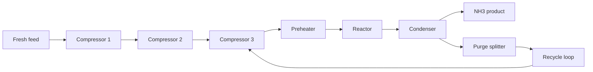

# Haber–Bosch process simulation and control formulation

This project uses a DWSIM-based Haber–Bosch ammonia process as the simulator for the reinforcement-learning environment. The underlying flowsheet is stored in `DWSIM Simulation/Ammonia_RL.dwxmz`, and the control interface is implemented through the Rosetta bridge in `.dwsim_support/dwsim_rosetta_bridge.py` and the Gym environment in `env.py`.

## Process concept

The simulated process is a closed-loop ammonia synthesis loop with the following operating structure:

- fresh feed enters the process at a controlled composition and ratio
- compressor stages raise the feed pressure into the recycle loop
- the gas is preheated before entry to the reactor
- the reactor synthesizes ammonia under temperature-controlled conditions
- the ammonia product is separated from the recycle loop using a condenser
- a purge split regulates inert accumulation
- the recycle circulation is used to maintain stable loop operation

## Schematic

## Control variables

The controller manipulates seven process variables in the DWSIM model:

| Symbol | Variable | Typical interpretation |
| --- | --- | --- |
| $x_1$ | feed ratio | fresh-feed composition ratio |
| $x_2$ | stage 1 pressure | compression stage 1 outlet pressure |
| $x_3$ | stage 2 pressure | compression stage 2 outlet pressure |
| $x_4$ | loop pressure | recycle loop operating pressure |
| $x_5$ | reactor temperature | reactor thermal operating point |
| $x_6$ | condenser temperature | condensation severity |
| $x_7$ | purge fraction | recycle inert management |

These values are normalized to the physical operating bounds defined in `env.py` before being applied to the DWSIM simulation.

## Observation vector

The environment reports a five-dimensional observation state derived from the DWSIM result:

1. NH3 production flow rate
2. total process power demand
3. reactor temperature
4. loop pressure
5. inert accumulation in the recycle loop

This observation vector is used consistently across BO, DreamerV3, and PPO evaluation.

## Reward function

The reward is calculated as an economic objective based on ammonia revenue minus utility and refrigeration costs:

$$
R = \text{Revenue}_{NH_3} - C_{compression} - C_{refrigeration} - C_{heating}
$$

The bridge computes the revenue from ammonia product flow and subtracts the cost contributions associated with compressor power, condenser refrigeration, and preheating demand.

## Why this matters

The simulation provides a realistic industrial optimization problem in which the policy must trade off production rate, energy use, and process stability. This makes the benchmark meaningful for comparing optimization-based and learning-based control strategies under representative operating constraints.
